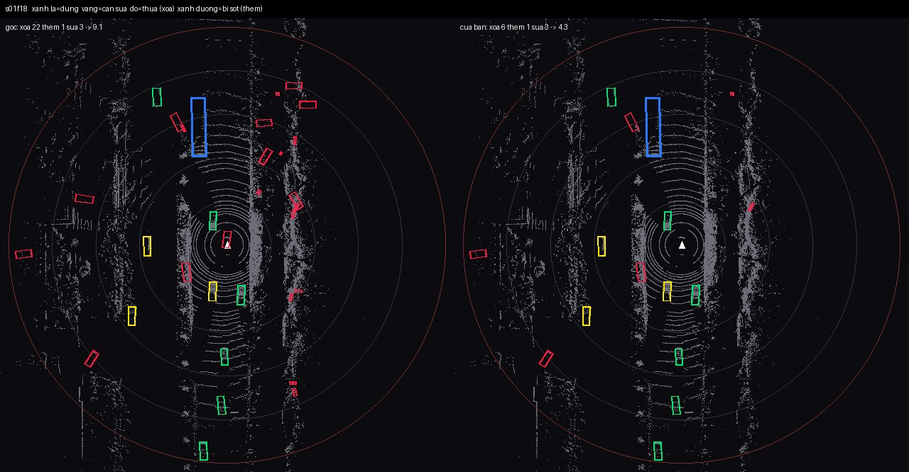

# Báo cáo Day 14 — Trần Xuân Bắc — 2A202603132

- Mã học viên dùng với `--student`: `2A202603132`
- `seed_tag` trong `frames_A.txt`: `393590736f`

## 1. Dự đoán trước sweep (bước 5b)

Ghi **trước** khi chạy `scripts/pp_sweep.py`, rồi commit và push ngay (lịch sử commit là bằng chứng thời điểm viết). Không sửa phần này sau khi có kết quả.

- **Tham số dự đoán** Tôi dự đoán tăng ngưỡng tin cậy score_thr lên 0.4 và đặt min_points=5 để loại bỏ các dự đoán có độ tin cậy thấp hoặc quá ít điểm LiDAR
- **Lý do dự đoán từ ảnh BEV hoặc số liệu tập A** Kết quả prelabel ban đầu trên tập A tạo ra 76 cuboid, trong khi nhãn tham chiếu chỉ có 38 cuboid. Số lượng cuboid cần xóa lên tới 41, cho thấy mô hình đang tạo ra khá nhiều dự đoán dư thừa. Vì vậy, tôi dự đoán tăng score_thr sẽ giúp hạn chế các đối tượng nhận diện không chắc chắn, còn tăng min_points giúp loại bỏ các hộp được tạo từ quá ít điểm LiDAR. Tôi kỳ vọng cấu hình này sẽ giảm số cuboid cần xóa và giảm tổng chi phí chỉnh sửa. Tuy nhiên, cần theo dõi nguy cơ bỏ sót các đối tượng nhỏ hoặc ở xa. 

## 2. Tập A: sửa tay và tune

Tập A gồm ba frame. Cấu hình gốc tạo 76 cuboid, còn bộ nhãn tham chiếu đã lưu trên CVAT gồm 38 cuboid. Chi phí được tính bằng `0,3 × xóa + 1,0 × thêm + 0,5 × sửa` trong phạm vi 50 m.

| Frame | Prelabel gốc | Tham chiếu | Xóa | Thêm | Sửa | Chi phí |
|---|---:|---:|---:|---:|---:|---:|
| `s01f18` | 31 | 10 | 22 | 1 | 3 | 9,10 |
| `s02f10` | 28 | 17 | 13 | 2 | 0 | 5,90 |
| `s04f48` | 17 | 11 | 6 | 0 | 0 | 1,80 |
| **Tổng** | **76** | **38** | **41** | **3** | **3** | **16,80** |

Công cụ hỗ trợ đối chiếu điểm LiDAR với ảnh camera đã được dùng để rà và xóa sơ bộ 26 cuboid prelabel thừa trong job 33. Các số xóa, thêm và sửa trong bảng là kết quả đo giữa `pred_A.json` và `ref_A.json` sau khi hoàn tất bước sửa tập A.

| Cấu hình | Xóa | Thêm | Sửa | Chi phí |
|---|---:|---:|---:|---:|
| Gốc | 41 | 3 | 3 | 16,8 |
| `best_config.json` | 7 | 4 | 3 | 7,6 |

`best_config.json` tăng `score_thr` từ `0.1` lên `0.5` và giữ `min_points=0`. Khi `score_thr=0.5`, cả ba giá trị `min_points` đã thử đều cho tổng chi phí 7,6 điểm.

| Frame giữ lại | `score_thr` chọn từ hai frame còn lại | `min_points` | Chi phí trên frame giữ lại | Mức thấp nhất trong lưới |
|---|---:|---:|---:|---:|
| `s01f18` | 0.5 | 0 | 4,3 | 4,3 |
| `s02f10` | 0.4 | 0 | 3,5 | 2,3 |
| `s04f48` | 0.5 | 0 | 1,0 | 0,3 |

Ngưỡng được chọn đổi ở một trong ba lượt leave-one-out. Chi phí trên `s02f10` và `s04f48` lần lượt cao hơn mức thấp nhất trong lưới 1,2 và 0,7 điểm. Cấu hình `0.5/0` được dùng cho tập B vì có tổng chi phí thấp nhất trên cả ba frame tập A.

## 3. Trước/sau (bước 8)

- Trên 3 frame tập A, `scripts/pp_compare.py` đo được tổng chi phí sửa giảm từ 16,8 xuống 7,6, tương đương khoảng 55%, khi tăng `score_thr` từ `0.1` lên `0.5`.
- Cấu hình dự đoán ở mục 1 (`score_thr=0.4`, `min_points=5`) có 14 hộp cần xóa, 3 hộp cần thêm và 3 hộp cần sửa, tổng 8,7 điểm trong `sweep.csv`.
- Kết quả ủng hộ dự đoán rằng tăng `score_thr` giúp giảm số hộp thừa. So với cấu hình dự đoán, cấu hình `0.5/0` giảm 7 hộp cần xóa, tăng 1 hộp cần thêm và giữ 3 hộp cần sửa. Chênh lệch là 1,1 điểm theo công thức tính chi phí. Ở cả hai ngưỡng `score_thr=0.4` và `0.5`, ba mức `min_points` đã thử cho cùng chi phí tại mỗi ngưỡng, nên tập A chưa cho thấy lợi ích riêng của `min_points=5` trong hai nhóm này.
- Phần đối chiếu được diễn đạt với hỗ trợ AI dựa trên các số liệu đã đo.

## 4. Tập B

Số liệu được đo trên 12 frame tập B với `best_config.json` và `ref_B.json` xuất từ Job 34. File tham chiếu có 149 cuboid.

| Xóa | Thêm | Sửa | Chi phí |
|---:|---:|---:|---:|
| 28 | 24 | 2 | 33,4 |

- Theo lớp hộp cần xử lý, **Car** tốn nhiều công nhất với 16 hộp cần xóa, 11 hộp cần thêm và 2 hộp cần sửa, tương ứng 16,8 điểm.
- Khi rà Job 34, trợ lý dùng gợi ý từ YOLOX và PointPillars rồi đối chiếu ảnh camera và LiDAR. Trợ lý đã hỗ trợ đổi lớp cho 5 hộp, thêm 18 hộp dạng Shape và xóa 26 hộp thừa trên CVAT.
- Ở frame `s02f30`, chiều rộng hộp Car `pp_id=8` còn chưa chắc chắn vì ảnh camera và điểm LiDAR chỉ cho thấy một phần vị trí này.

## 5. Giới hạn

- Tập A chỉ có 3 frame nên kết quả chọn cấu hình có thể phụ thuộc vào cảnh và số lượng vật thể của các frame đó.
- PointPillars trong lab được huấn luyện trên KITTI. Lớp Truck và Bus được suy ra theo kích thước của hộp dự đoán Car, nên cần đối chiếu lại bằng ảnh và LiDAR.
- Chi phí công sửa là điểm có trọng số theo số thao tác. Muốn quy đổi thành thời gian cần đo thời gian gán nhãn thực tế.
